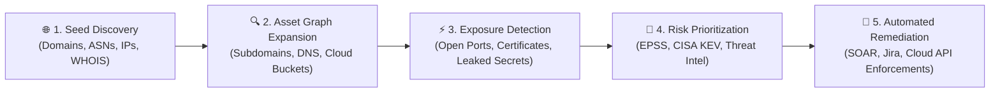

# 🌐 Awesome External Attack Surface Management (EASM) 🎯

> **A comprehensive, SEO-optimized, curated guide to the top External Attack Surface Management (EASM), Continuous Threat Exposure Management (CTEM), and cyber asset discovery tools — featuring enterprise SaaS platforms and self-hosted open-source security frameworks.** 🔍🛡️
>
> 🌟 **Star this repository to keep track of new EASM tools, releases, and vulnerability intelligence trends!** 🌟

---

## 📑 Table of Contents

- [🌐 Sector Overview & Market Dynamics](#-sector-overview--market-dynamics)
- [🏢 SaaS & Hosted Commercial Platforms](#-saas--hosted-commercial-platforms)
  - [📊 SaaS Platforms Comparison Matrix](#-saas-platforms-comparison-matrix)
  - [🔍 Detailed SaaS Platform Breakdown](#-detailed-saas-platform-breakdown)
- [🔓 Open-Source Software & Recon Tools](#-open-source-software--recon-tools)
  - [⭐ Open-Source Repositories Ranked by Stars](#-open-source-repositories-ranked-by-stars)
  - [🛠️ Detailed Open-Source Project Breakdown](#-detailed-open-source-project-breakdown)
- [⚖️ Feature Comparison at a Glance](#-feature-comparison-at-a-glance)
- [🚀 Key EASM Capabilities & Architecture](#-key-easm-capabilities--architecture)
- [📈 Star History](#-star-history)
- [💖 Support](#-support)
- [🤝 Contributing](#-contributing)
- [📄 License](#-license)

---

## 🌐 Sector Overview & Market Dynamics

The global **External Attack Surface Management (EASM)** market is estimated at **$1.2B to $1.8B in 2024–2026** and is projected to expand to over **$4.3B–$6.5B by 2030–2032** at a blistering compound annual growth rate (**CAGR of 24%–30%**), driven by rapid cloud migration, remote infrastructure dispersion, shadow IT sprawl, and the rise of Continuous Threat Exposure Management (CTEM). 

The market remains **moderately to highly fragmented** rather than a winner-take-all monopoly: while mega-cap platform incumbents (Microsoft, Palo Alto Networks, CrowdStrike, and Alphabet/Google Mandiant) are actively bundling EASM into broader XDR and CNAPP ecosystems, agile pure-play vendors (Censys, CyCognito, ProjectDiscovery) continue to lead independent innovation in internet-scale scanning, real-time asset graph intelligence, and automated adversarial testing.

---

## 🏢 SaaS & Hosted Commercial Platforms

Enterprise-grade, cloud-hosted External Attack Surface Management and Exposure Management platforms sorted descending by company scale (valuation / market capitalization / revenue).

### 📊 SaaS Platforms Comparison Matrix

| 🏢 Product / Vendor | 💰 Company Scale (Valuation / Mkt Cap) | 🏷️ Specific Starting Pricing Tier | 🎁 Specific Free Tier / Free Trial Limits | 🚀 Best For |
| :--- | :--- | :--- | :--- | :--- |
| **[Microsoft Defender EASM](https://learn.microsoft.com/en-us/azure/external-attack-surface-management/)** | **~$3.1 Trillion** (Market Cap) | **$0.011 / billable asset / day** (~$0.33/asset/month via Azure meter) | **30-day free trial** with full discovery of up to 10,000 assets | Azure-centric enterprises needing cloud-native EASM |
| **[Mandiant Advantage ASM](https://www.mandiant.com/advantage/attack-surface-management)** *(Google / Alphabet)* | **~$2.2 Trillion** (Market Cap) | **$18,480 / year** (Starting tier via Google Cloud Marketplace) | **30-day free trial** (curated trial upon sales request) | Organizations requiring threat intelligence correlation & IR backing |
| **[Cortex Xpanse](https://www.paloaltonetworks.com/cortex/cortex-xpanse)** *(Palo Alto Networks)* | **~$115 Billion** (Market Cap) | **~$50,000 / year** (~£70,000/yr base G-Cloud framework tier) | **30-day guided POC / trial** (up to 5 initial seed domains) | Large enterprises requiring active, daily internet-wide scanning |
| **[CrowdStrike Falcon Surface](https://www.crowdstrike.com/products/exposure-management/falcon-surface/)** | **~$80 Billion** (Market Cap) | **$75 – $85 / asset / year** (~£65/device/yr G-Cloud list price) | **15-day free trial** with full Falcon Exposure Management features | Teams already on CrowdStrike Falcon seeking unified exposure visibility |
| **[Rapid7 Surface Command](https://www.rapid7.com/products/surface-command/)** | **~$2.5 Billion** (Market Cap) | **$6.50 / asset / year** (~$30,000/yr platform minimum tier) | **30-day free trial** covering dynamic discovery of external perimeters | Organizations executing an automated CTEM exposure lifecycle |
| **[Recorded Future ASI](https://www.recordedfuture.com/platform/attack-surface-intelligence)** | **$5.25 Billion** (Acquired by Mastercard) | **~$50,000 / year** (Core Threat Intelligence + ASI module starting tier) | **30-day trial** via Recorded Future Intelligence Cloud with asset scoping | Threat-intel-driven prioritization focused on adversary targeting |
| **[NetSPI EASM](https://www.netspi.com/attack-surface-management/)** | **~$1.2 Billion** (Private Equity Valuation) | **~$35,000 / year** (Base EASM platform with analyst validation tier) | **14-day guided pilot** (evaluation across up to 3 root domains) | Organizations requiring human-led, continuous pentest validation |
| **[CyCognito](https://www.cycognito.com/)** | **~$800 Million** (Latest Venture Valuation) | **~$45,000 / year** (Enterprise tier starting at 5,000 monitored assets) | **14-day free attack surface snapshot** (limited to 1 corporate seed) | Teams prioritizing active DAST & immediate exploitability testing |
| **[Censys Attack Surface Management](https://censys.com/attack-surface-management/)** | **~$400 Million** (Venture Backed) | **$79 / month** ($948/yr Starter tier; ASM packages start at $12,000/yr) | **$0/month Free Community Plan** (5 searches/day, 250 API queries/mo) | Threat hunters wanting internet-wide search and AI agent integrations |
| **[ProjectDiscovery Cloud Platform](https://projectdiscovery.io/)** | **~$150 Million** (Venture Backed) | **$200 / seat / month** ($2,400/yr base paid tier with cloud runners) | **$0/month Free Tier** (1,000 findings/mo, unlimited Nuclei local sync) | Security engineers & bug hunters using Nuclei, Subfinder, & HTTPX |

---

### 🔍 Detailed SaaS Platform Breakdown

#### 1. 🛡️ Microsoft Defender EASM
* **Company Scale:** ~$3.1T Market Cap (Microsoft)
* **Pricing:** Pay-as-you-go via Azure consumption meter at **$0.011 per billable asset per day** (~$0.33/asset/month).
* **Free Tier / Trial:** **30-day free trial** per subscription, covering automated discovery across domains, subdomains, IPs, and ASNs.
* **Architecture:** Agentless, cloud-native discovery deployed as an Azure ARM resource. Performs recursive graph discovery based on seed domains, Autonomous System Numbers (ASNs), and whois records. Integrates natively with Microsoft Security Exposure Management and Microsoft Defender for Cloud.
* **Best For:** Azure-first enterprise estates seeking native integration into Microsoft Sentinel and Defender XDR.

#### 2. ⚡ Mandiant Advantage ASM *(Google / Alphabet)*
* **Company Scale:** ~$2.2T Market Cap (Alphabet)
* **Pricing:** Enterprise subscriptions starting at **$18,480 / year** via Google Cloud Marketplace.
* **Free Tier / Trial:** **30-day proof-of-concept trial** upon sales validation.
* **Architecture:** Scans the global IPv4 internet daily, discovering orphaned cloud resources, shadow SaaS, and unmanaged public endpoints, correlating findings with frontline Google/Mandiant threat intelligence.
* **Best For:** Enterprise security teams requiring deep nation-state threat intelligence correlation and incident response integration.

#### 3. 🌐 Cortex Xpanse *(Palo Alto Networks)*
* **Company Scale:** ~$115B Market Cap (NASDAQ: PANW)
* **Pricing:** Enterprise annual subscriptions beginning around **$50,000 to $95,000 / year** (public G-Cloud framework list ~£70,000/yr).
* **Free Tier / Trial:** **30-day guided trial / proof-of-concept** with restricted seed scanning.
* **Architecture:** Active internet-wide indexing platform scanning 4.3 billion IPv4 addresses multiple times daily and over 500 billion ports. Automatically attributes owned infrastructure without requiring customer agents or appliances.
* **Best For:** Global 2000 enterprises with distributed multi-cloud footprints already standardizing on Palo Alto Cortex XSOAR/XSIAM.

#### 4. 🦅 CrowdStrike Falcon Surface *(Exposure Management)*
* **Company Scale:** ~$80B Market Cap (NASDAQ: CRWD)
* **Pricing:** Module pricing starts at **$75 to $85 / asset / year** (~£65/device/year on public frameworks); platform bundles scale via Falcon Flex.
* **Free Tier / Trial:** **15-day free trial** of Falcon Exposure Management including external surface visibility.
* **Architecture:** AI-native external exposure mapping that pairs outside-in internet scanning with inside-out endpoint sensor intelligence. Correlates exposed assets with active adversary campaigns via Falcon Fusion SOAR.
* **Best For:** Organizations with widespread CrowdStrike Falcon agent deployments seeking consolidated exposure management.

#### 5. 🎯 Rapid7 Surface Command
* **Company Scale:** ~$2.5B Market Cap (NASDAQ: RPD)
* **Pricing:** Starting at **$6.50 / asset / year** for asset exposure management, with enterprise entry contracts around **$30,000 / year**.
* **Free Tier / Trial:** **30-day full-featured free trial** on Rapid7's Command Platform.
* **Architecture:** Dynamic continuous discovery that replaces static annual audits. Ingests DNS records, certificate logs, and cloud provider APIs to execute the four phases of CTEM: Scoping, Discovery, Prioritization, and Validation.
* **Best For:** Security operations teams looking to unify vulnerability management, internal asset hygiene, and external attack surface visibility.

#### 6. 🧠 Recorded Future Attack Surface Intelligence
* **Company Scale:** $5.25B Valuation (Acquired by Mastercard)
* **Pricing:** Core threat intelligence and ASI module packages start around **$50,000 / year**, scaling to $150,000+ for enterprise-wide coverage.
* **Free Tier / Trial:** **30-day evaluation access** to the Recorded Future Intelligence Cloud.
* **Architecture:** Leverages 10+ years of historical internet data, passive DNS, WHOIS graph links, and dark web monitoring to uncover forgotten domains, supply chain risks, and typosquatted domains.
* **Best For:** Threat intelligence units and red teams needing attacker-centric exposure data.

#### 7. 🕵️ NetSPI EASM
* **Company Scale:** ~$1.2B Enterprise Value (KKR-backed)
* **Pricing:** Contracts start around **$35,000 / year** based on asset volume and testing tiers.
* **Free Tier / Trial:** **14-day guided proof-of-value** covering automated discovery and attack surface scoping.
* **Architecture:** Combines continuous machine scanning with human-in-the-loop penetration testing validation. Uniquely filters false positives by verifying real exploit paths across cloud misconfigurations, open ports, and API vulnerabilities.
* **Best For:** Regulated financial institutions and healthcare enterprises wanting validated risk without alert fatigue.

#### 8. 🔍 CyCognito
* **Company Scale:** ~$800M Valuation (Sora Ventures, Accel)
* **Pricing:** Tiered annual subscriptions starting around **$45,000 / year** (typically baseline 5,000 asset tier).
* **Free Tier / Trial:** **14-day free external surface assessment snapshot**.
* **Architecture:** Performs autonomous reconnaissance and active DAST payload testing against web applications to test whether discovered vulnerabilities are exploitable from the internet.
* **Best For:** Organizations that need autonomous active verification of exposures across subsidiaries and acquisitions.

#### 9. 🔭 Censys Attack Surface Management
* **Company Scale:** ~$400M Valuation
* **Pricing:** Self-serve Search starts at **$79 / month** ($948/yr); dedicated Enterprise ASM plans start around **$12,000 / year**.
* **Free Tier / Trial:** **$0/month Free Tier** with 5 queries per day, 250 API credits/month, and community internet dataset search.
* **Architecture:** High-fidelity internet map driven by continuous scanning of 100+ ports across all 4 billion IPv4 addresses. Includes an MCP (Model Context Protocol) server for building custom LLM security agents.
* **Best For:** Threat hunters, incident responders, and teams wanting programmatic API access to global internet telemetry.

#### 10. ⚡ ProjectDiscovery Cloud Platform (PDCP)
* **Company Scale:** ~$150M Valuation (CRV, Point72)
* **Pricing:** Paid self-service tiers start at **$200 / seat / month** ($2,400/year) with hosted cloud scanners; Enterprise custom plans add VPC & SSO.
* **Free Tier / Trial:** **$0/month Free Community Tier** providing 1,000 vulnerability findings/month and unlimited CLI integration.
* **Architecture:** Cloud-native orchestrator for the widely adopted open-source offensive security tools (Nuclei, Subfinder, HTTPX, Naabu, Katana). Automatically triggers continuous vulnerability workflows upon asset discovery.
* **Best For:** AppSec teams, DevSecOps pipelines, and offensive security engineers using the Nuclei ecosystem.

---

## 🔓 Open-Source Software & Recon Tools

Community-built, self-hosted External Attack Surface Management tools, scanners, and recon automation engines sorted in descending order by GitHub Stars.

### ⭐ Open-Source Repositories Ranked by Stars

| 🛠️ Project Name | 🌟 GitHub Stars Badge | 💻 Primary Stack | 📜 License | 🎯 Key Architecture / Capability |
| :--- | :--- | :--- | :--- | :--- |
| **[ProjectDiscovery Nuclei](https://github.com/projectdiscovery/nuclei)** |  | Go | MIT | Fast, template-based exposure and vulnerability scanning engine |
| **[OWASP Amass](https://github.com/owasp-amass/amass)** |  | Go | Apache-2.0 | In-depth network mapping, DNS enumeration, and asset graph discovery |
| **[ProjectDiscovery Subfinder](https://github.com/projectdiscovery/subfinder)** |  | Go | MIT | Fast passive subdomain enumeration utilizing 40+ OSINT sources |
| **[1N3 Sn1per](https://github.com/1N3/Sn1per)** |  | Shell / Python | GPL-3.0 | Automated pentest & attack surface recon with 90+ tool integrations |
| **[reNgine](https://github.com/yogeshojha/rengine)** |  | Python / Django | GNU GPL-3.0 | Web application recon engine with pipeline orchestration & modern UI |
| **[six2dez reconftw](https://github.com/six2dez/reconftw)** |  | Bash / Python | MIT | Automated end-to-end multi-threaded reconnaissance and OSINT pipeline |
| **[Osmedeus](https://github.com/j3ssie/osmedeus)** |  | Go | MIT | Workflow-driven offensive security automation for continuous EASM |
| **[IVRE](https://github.com/ivre/ivre)** |  | Python | GNU GPL-3.0 | Self-hosted alternative to Shodan & Censys; passive & active network recon |
| **[Findomain](https://github.com/Findomain/Findomain)** |  | Rust | GPL-3.0 | Blazing fast subdomain monitoring, HTTP probing, and alerting tool |
| **[yyhuni xingrin](https://github.com/yyhuni/xingrin)** |  | TypeScript | GPL-3.0 | Modern authorized EASM platform with asset discovery & scan orchestration |
| **[Natlas](https://github.com/natlas/natlas)** |  | Python / Flask | MIT | Scalable, distributed port scanning & network attack surface explorer |
| **[EasyEASM](https://github.com/g0ldencybersec/EasyEASM)** |  | Go | MIT | Zero-dollar self-hosted attack surface monitor with Slack/Discord alerts |
| **[Open-ASM](https://github.com/oasm-platform/open-asm)** |  | Python / Go | Apache-2.0 | Open-source ASM platform for discovering assets & owning security data |
| **[LunaFox](https://github.com/yyhuni/lunafox)** |  | Go / Vue | GPL-3.0 | Distributed agent-based EASM and vulnerability scanner orchestration |
| **[OpenEASD](https://github.com/cybersecify/OpenEASD)** |  | Python / Docker | MIT | Single-command Docker EASM scanner ranked with EPSS/KEV exploit scoring |

---

### 🛠️ Detailed Open-Source Project Breakdown

#### 1. ⚡ [ProjectDiscovery Nuclei](https://github.com/projectdiscovery/nuclei)
* **GitHub Stars:**  | **License:** MIT | **Stack:** Go
* **Overview:** The de facto standard open-source vulnerability scanner powered by YAML DSL templates. Emitted across thousands of security teams to validate exposed technologies, CVEs, misconfigurations, and leaked sensitive files across newly identified attack surface targets.

#### 2. 🗺️ [OWASP Amass](https://github.com/owasp-amass/amass)
* **GitHub Stars:**  | **License:** Apache-2.0 | **Stack:** Go
* **Overview:** Flagship OWASP project for in-depth network attack surface mapping and external asset discovery. Gathers data from 55+ open-source intelligence feeds, certificate transparency logs, active DNS brute forcing, routing tables, and web archives to construct rich graph databases of target infrastructure.

#### 3. 🔍 [ProjectDiscovery Subfinder](https://github.com/projectdiscovery/subfinder)
* **GitHub Stars:**  | **License:** MIT | **Stack:** Go
* **Overview:** Fast passive subdomain enumeration tool designed to discover valid subdomains of websites using passive online sources. Engineered for speed, stability, and modular integration into custom EASM pipeline scripts.

#### 4. 🎯 [1N3 Sn1per](https://github.com/1N3/Sn1per)
* **GitHub Stars:**  | **License:** GPL-3.0 | **Stack:** Shell / Python
* **Overview:** Comprehensive automated reconnaissance and penetration testing framework. Orchestrates 90+ security tools and 10,000+ detections to discover attack surfaces, execute vulnerability scans, and generate professional HTML/PDF reports.

#### 5. 🎨 [reNgine](https://github.com/yogeshojha/rengine)
* **GitHub Stars:**  | **License:** GPL-3.0 | **Stack:** Python (Django) / Celery / Docker
* **Overview:** An automated reconnaissance framework with a sleek dashboard UI, configurable scan engines, continuous monitoring diffs, and database storage for penetration testers and corporate security teams.

#### 6. 🚀 [six2dez reconftw](https://github.com/six2dez/reconftw)
* **GitHub Stars:**  | **License:** MIT | **Stack:** Bash / Python
* **Overview:** Multi-threaded automated recon suite that executes end-to-end enumeration: subdomain discovery, web probing, visual screenshots, port scanning, OSINT investigations, directory fuzzing, and vulnerability scanning in one command.

#### 7. ⚙️ [Osmedeus](https://github.com/j3ssie/osmedeus)
* **GitHub Stars:**  | **License:** MIT | **Stack:** Go
* **Overview:** Highly flexible offensive security engine designed for building custom reconnaissance workflows, distributed asset mapping, and automated cloud infrastructure probing.

#### 8. 🌐 [IVRE](https://github.com/ivre/ivre)
* **GitHub Stars:**  | **License:** GPL-3.0 | **Stack:** Python / MongoDB
* **Overview:** Self-hosted network reconnaissance framework allowing organizations to build private alternatives to Shodan and ZoomEye. Integrates Nmap, Masscan, Zeek, and p0f into an enterprise data analytics dashboard.

#### 9. ⚡ [Findomain](https://github.com/Findomain/Findomain)
* **GitHub Stars:**  | **License:** GPL-3.0 | **Stack:** Rust
* **Overview:** High-speed subdomain intelligence tool written in Rust. Features automated continuous subdomain monitoring, HTTP service verification, port scanning, and instant alerting via Slack, Discord, and Telegram webhooks.

#### 10. 🛡️ [yyhuni xingrin](https://github.com/yyhuni/xingrin)
* **GitHub Stars:**  | **License:** GPL-3.0 | **Stack:** TypeScript / Node.js
* **Overview:** Modern authorized attack surface management and security automation platform with asset discovery, service probing, scan orchestration, and security issue remediation tracking.

#### 11. 🧭 [Natlas](https://github.com/natlas/natlas)
* **GitHub Stars:**  | **License:** MIT | **Stack:** Python / Flask / ElasticSearch
* **Overview:** Distributed, scalable network scanning and EASM explorer. Employs independent scan agents that feed findings into a centralized, searchable web portal.

#### 12. 💡 [EasyEASM](https://github.com/g0ldencybersec/EasyEASM)
* **GitHub Stars:**  | **License:** MIT | **Stack:** Go
* **Overview:** Lightweight, zero-cost attack surface monitoring tool designed for lean security teams. Continuously checks for new subdomains, open ports, and live HTTP services, piping immediate alerts into Slack and Discord.

#### 13. 📦 [Open-ASM](https://github.com/oasm-platform/open-asm)
* **GitHub Stars:**  | **License:** Apache-2.0 | **Stack:** Python / Go
* **Overview:** Open-source foundation for attack surface management. Discovers external assets, inventories DNS records, flags exposures, and gives enterprises 100% data ownership.

#### 14. 🦊 [LunaFox](https://github.com/yyhuni/lunafox)
* **GitHub Stars:**  | **License:** GPL-3.0 | **Stack:** Go / Vue
* **Overview:** Self-hosted EASM platform featuring distributed scanning agents, asset discovery pipelines, and vulnerability lifecycle workflows.

#### 15. 🐳 [OpenEASD](https://github.com/cybersecify/OpenEASD)
* **GitHub Stars:**  | **License:** MIT | **Stack:** Python / Shell / Docker Compose
* **Overview:** Self-hosted external attack surface scanner running 30+ tools across 13 stages in a single `docker compose up`. Automatically prioritizes vulnerabilities using EPSS and CISA KEV (Known Exploited Vulnerabilities) scores.

---

## ⚖️ Feature Comparison at a Glance

| 🛡️ Software Platform | 📜 License Model | 🌐 Internet-Wide Scan | ⚡ Active Pentest / DAST | 📊 Graph Asset Mapping | 🎯 Best Focus Area |
| :--- | :--- | :---: | :---: | :---: | :--- |
| **Microsoft Defender EASM** | Commercial SaaS | ❌ *(Seed-based)* | ⚠️ *(Limited)* | ✅ | Azure & Microsoft 365 environments |
| **Mandiant Advantage ASM** | Commercial SaaS | ✅ *(Daily)* | ❌ | ✅ | Threat intelligence correlation & incident response |
| **Cortex Xpanse** | Commercial SaaS | ✅ *(IPv4 daily)* | ❌ | ✅ | Global enterprise attack surface at scale |
| **CrowdStrike Falcon Surface**| Commercial SaaS | ❌ *(Dynamic)* | ⚠️ *(Limited)* | ✅ | CrowdStrike Falcon XDR ecosystem integration |
| **Rapid7 Surface Command** | Commercial SaaS | ✅ *(IPv4)* | ❌ | ✅ | Continuous Threat Exposure Management (CTEM) |
| **Recorded Future ASI** | Commercial SaaS | ❌ *(Threat Intel)* | ❌ | ✅ | Dark web & adversary-centric intelligence |
| **NetSPI EASM** | SaaS + Service | ❌ *(Targeted)* | ✅ *(Continuous)* | ✅ | Human-validated penetration testing findings |
| **CyCognito** | Commercial SaaS | ❌ *(Customer Scope)* | ✅ *(Automated DAST)*| ✅ | Active exploitability & path verification |
| **Censys ASM** | Freemium SaaS | ✅ *(Internet-wide)* | ⚠️ *(API)* | ✅ | Threat hunting & LLM agent integration |
| **ProjectDiscovery Cloud** | Freemium SaaS | ❌ *(Workflow-based)*| ✅ *(Nuclei DSL)* | ✅ | AppSec engineers & open-source security teams |
| **OWASP Amass** | Open Source | ❌ *(Recon-based)* | ❌ | ✅ | Deep DNS enumeration & red team mapping |
| **ProjectDiscovery Nuclei** | Open Source | ❌ *(Targeted)* | ✅ *(Payload testing)*| ❌ | Community vulnerability scanning engine |
| **reNgine** | Open Source | ❌ *(Targeted)* | ⚠️ *(Integrated)* | ✅ | Visual web app recon & monitoring dashboard |
| **IVRE** | Open Source | ✅ *(Self-hosted)* | ⚠️ *(Via Nmap)* | ✅ | Self-hosted Shodan/Censys alternative |
| **OpenEASD** | Open Source | ❌ *(Docker pipeline)*| ⚠️ *(Detection)* | ❌ | EPSS & CISA KEV vulnerability prioritization |

---

## 🚀 Key EASM Capabilities & Architecture

When evaluating External Attack Surface Management solutions, security teams typically inspect five foundational pillars:

1. **🌐 Continuous Seed Discovery:** Automated discovery of shadow IT, subsidiaries, acquisitions, and forgotten hosting environments from root domains and ASN blocks.
2. **🔍 Asset Graph Expansion:** Multi-tier relationship mapping connecting root apex domains to cloud buckets (S3, Azure Blobs), CDN edges, and microservice APIs.
3. **⚡ Exposure & Hygiene Detection:** Rapid identification of expired SSL certificates, DNS dangling records (subdomain takeover risks), and exposed administrative interfaces.
4. **🎯 Threat-Informed Prioritization:** Leveraging Exploit Prediction Scoring System (EPSS) and CISA's Known Exploited Vulnerabilities (KEV) catalog rather than raw CVSS scores alone.
5. **🚀 Workflow Mobilization:** Bi-directional webhooks and integrations into SIEM/SOAR platforms (Sentinel, XSOAR, Splunk, Tines) and developer ticketing systems (Jira, GitHub Issues).

---

## 📈 Star History

---

## 💖 Support

Thank you so much for visiting and utilizing this guide! 🙏

If you found this curated External Attack Surface Management repository helpful to your team, research, or projects:
- ⭐ **Star** this repository to help other cybersecurity professionals find it!
- 🍴 **Fork** it to build and customize your own internal offensive security checklists.
- 📢 **Share** it across your favorite security communities, LinkedIn, X/Twitter, or Reddit.

If you would like to support the ongoing maintenance and curation of open-source security intelligence:

Or visit the [GitHub Sponsors Dashboard](https://github.com/sponsors/ishandutta2007) directly. Thank you for your generosity and support! ☕✨

---

## 🤝 Contributing

Contributions, feature suggestions, and tool additions are warmly welcomed! 🌟

If you maintain or love an open-source or enterprise EASM project that is actively maintained, please feel free to:
1. Fork this repository 🍴
2. Create your feature branch (`git checkout -b feature/add-new-easm-tool`)
3. Commit your changes (`git commit -m 'feat: Add New-EASM-Tool'`)
4. Push to the branch (`git push origin feature/add-new-easm-tool`)
5. Open a well-documented Pull Request 🚀

Please ensure all added open-source projects include their GitHub URL, active license, primary language stack, and a clear explanation of what makes them stand out.

---

## 📄 License

This compilation is distributed under the **Creative Commons Zero v1.0 Universal** ([CC0 1.0](https://creativecommons.org/publicdomain/zero/1.0/)) public domain dedication. Listed commercial platforms and open-source software tools are property of their respective owners and maintainers.

---

**⭐ Found this EASM directory helpful? Star this repository to support continuous updates! ⭐**

Made with ❤️ for the global Infosec, AppSec, and Threat Intelligence communities.

